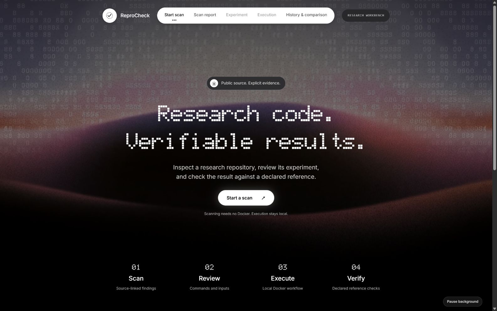
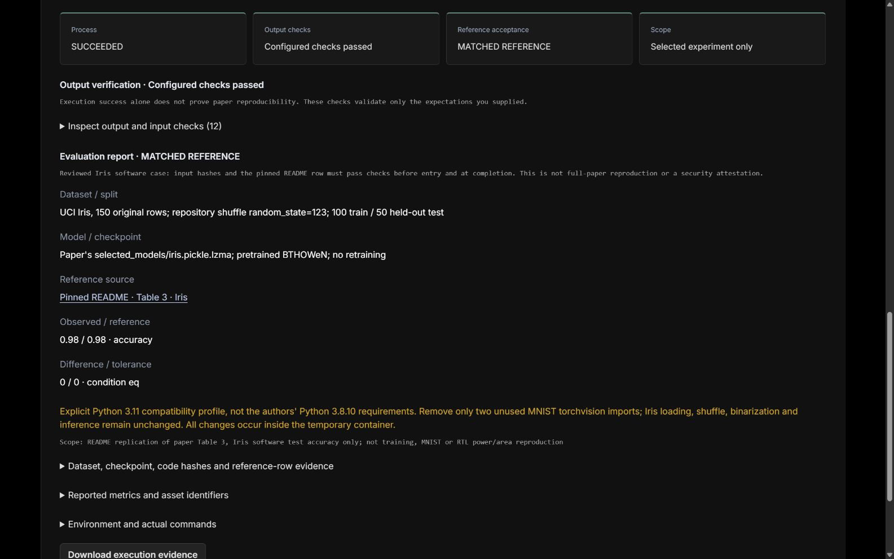

# ReproCheck

Check public Python research and JavaScript/TypeScript repositories, then run and verify explicitly reviewed experiments.

For students and researchers trying to run someone else's research code: get source-linked findings, a preparation plan, and a report comparing an experiment's observed result with its declared reference. Findings are tied to a fixed Git commit.



## Access and versions

**Start locally using the instructions below. No verified public demo URL is currently available.** The Sites project ID stored in this repository is deployment metadata, not a visitor link; it does not confirm that a live site is accessible.

| Entry | What it provides |
| --- | --- |
| Local app (`http://127.0.0.1:5173/`) | Repository scanning and reports; supported experiment execution, verification and comparison with local Docker. Anyone can install and run their own copy. |
| Sites deployment, when available | Repository scanning and reports only. It cannot use Docker on your computer or a visitor's computer. |

`main` uses the JavaScript scanner and Node.js local server. The Python/FastAPI scanning refactor is preserved separately on `feat/fastapi-scan`; it is not required for this quick start. The project still uses Python inside supported experiments and evidence collection.

## First run: scan only

The web interface supports **English and 简体中文**. Use **中文 / EN** in the header to switch; your choice is saved in this browser. The initial language follows your browser. Switching preserves the current form and run. Commands, source evidence, raw logs and downloaded JSON remain in their original form. Unrecognized upstream messages are shown unchanged.

Install **Node.js 22.12+ (Node 24 recommended)** and **Git**. **Scanning does not need Docker** and does not execute repository code.

```sh
git clone https://github.com/CHENYUAN0813/reprocheck.git
cd reprocheck
npm ci
npm run dev
```

On Windows PowerShell, use `npm.cmd` instead of `npm` if script execution is blocked. Keep the terminal open and visit **http://127.0.0.1:5173/**.

On **Start scan**, select **Start a scan** to reach the repository form (or scroll down). Enter a public GitHub repository URL and select **Scan repository**. The **Scan report** view shows findings with file/line evidence, suggested fixes and a recommended entry when one is recognized. Choose **Configure experiment →** to review the workflow and its missing steps. An ordinary scan follows the current default branch; reviewed examples pin their source revision.

If GitHub returns `401`/`403`, or port `5173` is occupied, see [token setup and troubleshooting](docs/advanced-usage.md#token-setup-and-troubleshooting).

## First execution: the Iris example

Use **Docker Desktop with Linux containers** for execution (not for scanning). Wait until its engine is running. This small CPU case needs the runner's **2 CPU / 2 GB** allocation, internet access for the image/dependencies, and free disk space. There is no GPU requirement. The execution limit is **10 minutes**, not an estimate; a first image download can take longer than a warm run.

1. On **Start scan**, select **Start a scan**, expand **Explore reviewed examples** below the repository form, and choose **Load published Iris benchmark** (not Iris training).
2. The **Experiment** view opens with the reviewed plan. Select **Check local runner**, then review the pinned source, effective commands and compatibility notes. Docker must be available before execution is enabled.
3. Tick the temporary-container execution acknowledgement and select **Run Evaluation**. The **Execution** view opens with stage progress and logs.
4. Expect **Process: SUCCEEDED**, **Output checks: Configured checks passed**, and **Reference acceptance: MATCHED REFERENCE**, with observed/reference accuracy **0.98 / 0.98** (49 correct out of 50 held-out samples). Expand **Inspect output and input checks** to examine the evidence.
5. Select **Download execution evidence**. Use **History & comparison → View record** to reopen a saved result, including after refreshing the page.



**Process: SUCCEEDED** only means the commands exited normally. **Configured checks passed** means the declared output checks and this case's input identities passed. **MATCHED REFERENCE** means the observed metric met the configured reference condition. The scope remains the **selected experiment only**: Iris evaluates a pretrained model; it does not retrain it or reproduce an entire paper. A failure is a result to inspect, not a reason to silently change the reference.

Refreshing or reopening the same local address in the same browser restores the last scan report, view and execution record. Restoring a record never starts a new run. Keep the local server running for an active task to continue; restarting the server may interrupt it. Applied npm and multi-service configurations are saved locally; other unsaved experiment drafts, API keys and execution consent are not restored. Download configurations you need to keep. Configuration review reopens at the saved report. Saved execution records also remain in History & comparison. Browser storage must be enabled; clearing it removes this workspace shortcut, not server-side run records.

Keep the server open while running. Do not run `npm test` during an experiment under `npm run dev`: some tests temporarily edit example fixtures and can trigger a watcher restart. For a run without file watching, use `node server.mjs` instead of `npm run dev` (in the same token-configured terminal).

## JavaScript / TypeScript scans

Scanning detects Python, JavaScript/TypeScript, mixed and unknown projects. JS/TS reports read up to five `package.json` files, parse npm lock files, show declared Node version requirements and scripts, and recognize README `npm` / `npm.cmd` commands. Mixed projects receive both applicable rule sets; unknown projects are not assigned Python experiment requirements.

For `CHENYUAN0813/rumor-control`, review installation, test/build tasks, the Vite service entry and the Ollama prerequisite. **Scanning reads declarations; it does not execute them.** Continue with the configuration-driven flow below to actually install and run a single npm application. `npm run dev` needs readiness and browser checks, not merely an exit-code check.

## Run a single npm application

1. Start Docker Desktop and run `npm run setup:web` once (repeat after browser-script updates).
2. Scan a public npm repository. Select **Review and run web acceptance →** to open **Configured npm application**. The generated plan uses the scanned repository and fixed commit. For a single root npm package, supported standalone README commands take priority and show their source lines; missing steps are suggested from `package.json`. Ambiguous service entries require selection. Other commands and external services are flagged for review, not silently executed.
3. Review the installation → tests → build → service → browser plan. Open **Advanced configuration and import / export** only to edit commands, port or conditions (`npm ci` requires a committed lock). Use finite test/build scripts, not watch mode. Missing tests are **SKIPPED / not verified**, never counted as passed. Optionally require specific page text.
4. Check the environment, acknowledge execution, then select **Run web verification**. The runner fetches the fixed commit, checks the selected scripts exist, installs dependencies, runs the configured tasks, starts the service and opens Chromium. No repository-specific ReproCheck code is required.
5. Download the npm configuration to share or reuse it. Importing selects its pinned source; inspect that source before confirming. The current npm form is also saved in this browser, without execution consent. Results, stage status, configuration and screenshots remain in local history. Retry uses fresh temporary containers.

**Current scope:** public GitHub, one npm package, Node 24.14.0, no workspaces/symlinks/submodules, no environment secrets or connected databases/model services. Installation has network access; tests/build/runtime are offline. Each container has 2 CPUs; app memory is 2 GB and browser memory 1 GB, with a total ten-minute deadline. Temporary containers are removed; image caches and local evidence remain on disk.

The browser checks successful HTTP response, visible text (or the configured text) and uncaught exceptions during page load. **Passing these checks does not establish that all business features work.** Existing reviewed cases add their own business assertions. Test the generic path with `node test-npm.mjs --docker`: it uses the same executor for pinned Rumor Control and `amannn/vite-react-starter`, and covers cancellation/retry and an intentionally failing text condition.

## Run Rumor Control from its scan report

1. Start Docker Desktop and run `npm run setup:web` (also run this once after updating the acceptance scripts).
2. Scan `https://github.com/CHENYUAN0813/rumor-control`. The reviewed commit is `b4775b30554f00b1deb9051279fc4facbd7d8ba0`.
3. In **Web verification**, select **Rumor Control** for the reviewed game-specific checks. The scan-report button opens the generic npm configuration described above; it does not run these game actions. Inspect the commands, check the execution confirmation, then select **Run web verification**. The displayed fixed commit is the version executed, regardless of the latest upstream branch.
4. Watch npm installation, tests, lint, build, Vite readiness and Chromium checks. A successful run records investigation, evidence submission with Ollama unavailable, and save/reload checks. Download the execution evidence or reopen it in history; retry starts clean temporary containers.

**Live Ollama inference is NOT RUN.** The browser checks the real application's failure fallback, with no fake model responses. This acceptance does not validate all ten rounds, winning strategy, or model quality. Dependencies install with network access; subsequent tests and browser steps run offline. No host ports or folders are exposed. The existing browser image is reused (Node 24), and temporary containers are removed after completion/cancellation. This is a reviewed case, not arbitrary-repository automatic execution.

## Web application acceptance

The **Web verification** view supports a pinned **React + FastAPI + SQLite task planner**
from a private Sydney GitHub repository, plus the bundled JS/TypeScript notes fixture.
It installs dependencies, builds and starts the frontend/backend, then uses Chromium to
check task creation, editing, completion, deletion and persistence after reload. Reports
include screenshots, assertions, logs and local history. Live Gemini generation is an
optional, separately reported check.

Run `npm run setup:planner` for the real case (requires school repository access), or
`npm run setup:web` for the self-contained notes fixture. Docker is required. This is
support for **two reviewed cases**, not arbitrary JavaScript repositories.
See [setup, credentials, evidence and boundaries](docs/web-verification.md).

## What the results do—and do not—mean

- Scanning covers the README, the primary dependency file and up to five likely source/configuration files; other files are checked by path. It is not a complete code audit.
- Reviewed examples and explicitly configured CPU experiments can run through the **local Docker-backed server**. Hosted deployments offer scanning, not Docker execution.
- Repository code runs with network access in a temporary container without host mounts or host credentials. Review commands before executing; container evidence is not a security certification.
- **Passing checks does not mean an entire paper was reproduced.** Iris verifies a pretrained-model case. The [Spotify case](docs/spotify-case.md) verifies a 15-cell deterministic CPU subset, not all paper experiments.

## Detailed documentation

- [Advanced usage](docs/advanced-usage.md): token setup, CLI, candidate selection, training configuration, paper matrices and full limitations.
- [Result verification](docs/verification.md): metric formats, checks, evidence, saved records and result meanings.
- [Frozen recipes and replay](docs/replay.md): repeat a saved configuration and interpret comparisons.
- [Reviewed examples](docs/reviewed-cases.md): BTHOWeN evaluation/training protocols, compatibility choices and measured results.
- [Testing and first-time-user feedback](docs/testing.md): commands, coverage and the still-pending classmate trial.
- [Spotify case study](docs/spotify-case.md): workflow, actual screenshots, 15/15 matched results and the disk-full failure.

## Configurable Node.js / Python services

The web acceptance page can run a pinned public repository using a multi-service plan. Run `npm run setup:services` once, scan the repository, review the generated draft, and confirm execution. Services share a disposable application container; the browser has a separate filesystem. Installation has network access; tests and services run offline.

See [multi-service plans](docs/multi-service-plans.md) for configuration, limits, and an importable full-stack example. A successful run verifies only the declared checks, not all business features or model inference.
