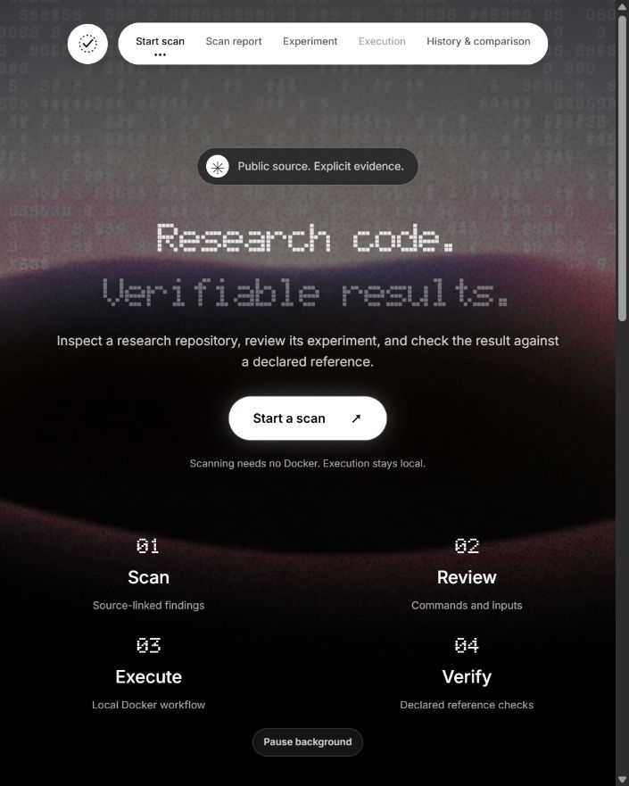
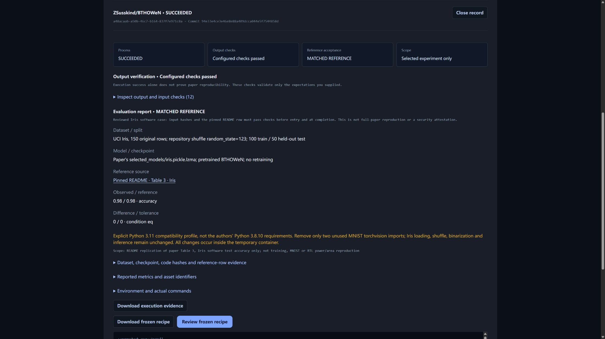

# ReproCheck

Check public Python research repositories, then run and verify explicitly reviewed experiments.

For students and researchers trying to run someone else's research code: get source-linked findings, a preparation plan, and a report comparing an experiment's observed result with its declared reference. Findings are tied to a fixed Git commit.



## First run: scan only

Install **Node.js 22.12+ (Node 24 recommended)** and **Git**. **Scanning does not need Docker** and does not execute repository code.

```sh
git clone https://github.com/CHENYUAN0813/reprocheck.git
cd reprocheck
npm ci
npm run dev
```

On Windows PowerShell, use `npm.cmd` instead of `npm` if script execution is blocked. Keep the terminal open and visit **http://127.0.0.1:5173/**.

On **Start scan**, select **Start a scan** to reach the repository form (or scroll down). Enter a public GitHub repository URL and select **Scan repository**. The **Scan report** view shows findings with file/line evidence, suggested fixes and a recommended entry when one is recognized. Choose **Configure experiment →** to review the workflow and its missing steps. An ordinary scan follows the current default branch; reviewed examples pin their source revision.

If GitHub returns `401`/`403`, or port `5173` is occupied, see [token setup and troubleshooting](docs/advanced-usage.md#token-setup-and-troubleshooting).

## First execution: the Iris example

Use **Docker Desktop with Linux containers** for execution (not for scanning). Wait until its engine is running. This small CPU case needs the runner's **2 CPU / 2 GB** allocation, internet access for the image/dependencies, and free disk space. There is no GPU requirement. The execution limit is **10 minutes**, not an estimate; a first image download can take longer than a warm run.

1. On **Start scan**, select **Start a scan**, expand **Explore reviewed examples** below the repository form, and choose **Load published Iris benchmark** (not Iris training).
2. The **Experiment** view opens with the reviewed plan. Select **Check local runner**, then review the pinned source, effective commands and compatibility notes. Docker must be available before execution is enabled.
3. Tick the temporary-container execution acknowledgement and select **Run Evaluation**. The **Execution** view opens with stage progress and logs.
4. Expect **Process: SUCCEEDED**, **Output checks: Configured checks passed**, and **Reference acceptance: MATCHED REFERENCE**, with observed/reference accuracy **0.98 / 0.98** (49 correct out of 50 held-out samples). Expand **Inspect output and input checks** to examine the evidence.
5. Select **Download execution evidence**. Use **History & comparison → View record** to reopen a saved result, including after refreshing the page.



**Process: SUCCEEDED** only means the commands exited normally. **Configured checks passed** means the declared output checks and this case's input identities passed. **MATCHED REFERENCE** means the observed metric met the configured reference condition. The scope remains the **selected experiment only**: Iris evaluates a pretrained model; it does not retrain it or reproduce an entire paper. A failure is a result to inspect, not a reason to silently change the reference.

Switching views preserves the current form. Refreshing the browser clears unsaved configuration; download a configuration before leaving if you need it later. Saved execution records remain in the local history.

Keep the server open while running. Do not run `npm test` during an experiment under `npm run dev`: some tests temporarily edit example fixtures and can trigger a watcher restart. For a run without file watching, use `node server.mjs` instead of `npm run dev` (in the same token-configured terminal).

## What the results do—and do not—mean

- Scanning covers the README, the primary dependency file and up to five likely source/configuration files; other files are checked by path. It is not a complete code audit.
- Reviewed examples and explicitly configured CPU experiments can run through the **local Docker-backed server**. Hosted deployments offer scanning, not Docker execution.
- Repository code runs with network access in a temporary container without host mounts or host credentials. Review commands before executing; container evidence is not a security certification.
- **Passing checks does not mean an entire paper was reproduced.** Iris verifies a pretrained-model case. The [Spotify case](docs/spotify-case.md) verifies a 15-cell deterministic CPU subset, not all paper experiments.

## Detailed documentation

- [Advanced usage](docs/advanced-usage.md): token setup, CLI, candidate selection, training configuration, paper matrices and full limitations.
- [Result verification](docs/verification.md): metric formats, checks, evidence, saved records and result meanings.
- [Frozen recipes and replay](docs/replay.md): repeat a saved configuration and interpret comparisons.
- [Reviewed examples](docs/reviewed-cases.md): BTHOWeN evaluation/training protocols, compatibility choices and measured results.
- [Testing and first-time-user feedback](docs/testing.md): commands, coverage and the still-pending classmate trial.
- [Spotify case study](docs/spotify-case.md): workflow, actual screenshots, 15/15 matched results and the disk-full failure.
