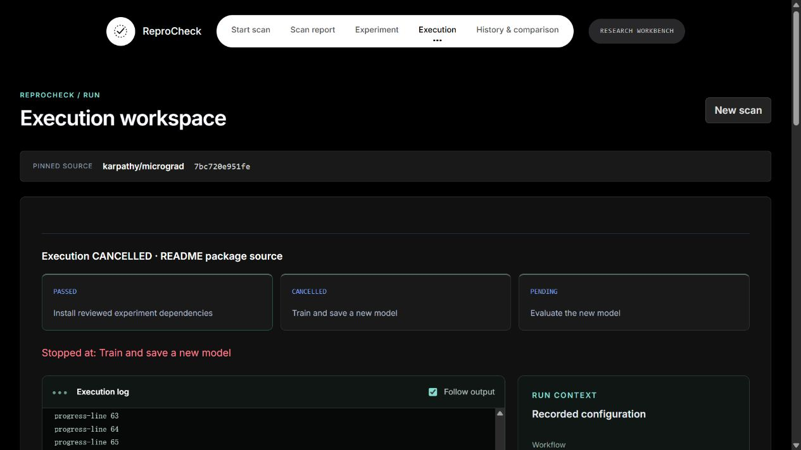

# Evidence workbench UI acceptance

Branch: `feat/stitch-evidence-workbench`
Base: `4a4e72b` (cinematic workbench UI)

## Scope

- Existing video landing page retained.
- Report: grouped check list, problem filter, selected evidence and suggested next step.
- Configuration: commands/model hand-off, protocol and metric-output sections; existing review gates retained.
- Execution: stage cards, scrollable console with optional output following, recorded resource limits and source identity. No invented live telemetry.
- Comparison: baseline/current table, explicit missing values, expandable structured values; differences remain separate from acceptance.
- No backend, API, experiment schema or execution-policy changes.

## Checks performed

- Full `npm test` suite, including grouping and zero/false/missing comparison value checks.
- Production client and worker build; `git diff --check`.
- Final review keeps execution status announcements separate from noisy log updates.
- Browser: actual karpathy/micrograd scan, pinned report, selected evidence, problem filter.
- Browser: Training form edits survive navigation; unconfirmed Apply remains disabled.
- Browser: existing successful Iris record renders log, recorded limits and acceptance independently.
- Browser: existing KTS-o7/AIML-Lab replay renders comparison values and older-record fallback.
- Responsive: 390px report/configuration/comparison, no document horizontal overflow. Comparison table scrolls within its region.
- Browser console: no error entries during acceptance.

## Screenshots

- [Report](ui-preview/evidence-report.png)
- [Configuration](ui-preview/evidence-config.png)
- [Recorded execution](ui-preview/evidence-run.png)
- [Comparison](ui-preview/evidence-comparison.png)

## Live Docker acceptance — 2026-10-26

All actions used the real local web interface and Docker Linux engine. The fixture is a synthetic scalar-regression smoke test, not a paper reproduction: Micrograd learns weight 2 from (1, 2), writes a new JSON checkpoint, reloads it, and evaluates squared error on (3, 6). The training command waits 30 seconds and prints 80 progress lines to exercise logs and cancellation. Source commit: `karpathy/micrograd@7bc720e951fe422b8f8814aa5aa1b64121d26b4c`.

| Scenario | Saved run ID | Observed result |
| --- | --- | --- |
| Controlled install failure | `5e6442fd-a581-4faf-abfe-ad1934180147` | FAILED at install; verification incomplete; official PyPI retry available |
| Click official PyPI retry | `74311ad8-da16-463a-826d-111b971dfa77` | SUCCEEDED, VERIFIED, MATCHED_REFERENCE; loss 0; all three stages passed |
| Cancel during training | `fbbc4295-886f-4c4e-893d-b586c7f96b02` | CANCELLED; training cancelled, evaluation pending; verification INCOMPLETE |

Failure injection used `pip install micrograd==0.1.0 --index-url http://127.0.0.1:9/simple --retries 0 --timeout 3` inside the temporary container. Retry changed the effective package source to official PyPI. Assertions against persisted records confirmed the source commit and execution options were unchanged between failure and retry. Cancellation used the same fixture with an explicitly valid PyPI source.

Live log following reached the bottom; manually returning to the top disabled following; checking Follow output restored it. The successful run transitioned all stage cards to PASSED. Cancellation removed the Cancel button. A fresh Node process read all three saved records and asserted their final states. Docker inspection confirmed all three test containers were removed; unrelated containers were left untouched. Browser error log was empty after the final run. Full automated tests and production builds passed again.

## Remaining scope

No fresh large-model or complete Spotify matrix run was performed. This verifies the UI execution, package-source retry and cancellation paths with a small real container workload; it is not exhaustive coverage of Docker daemon failures, timeouts or every supported experiment.
