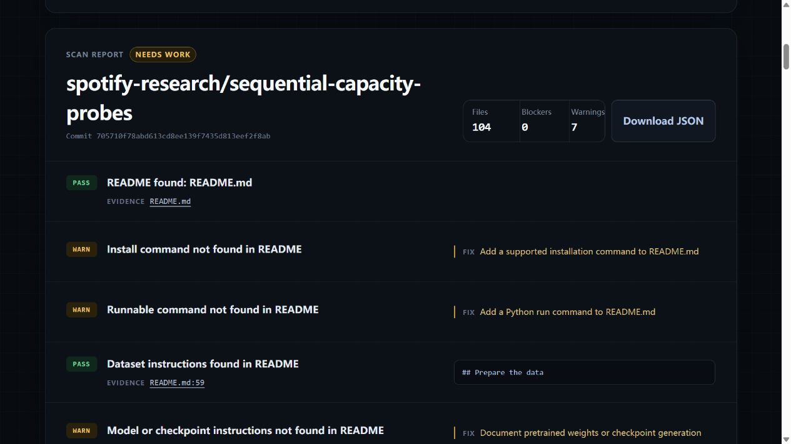
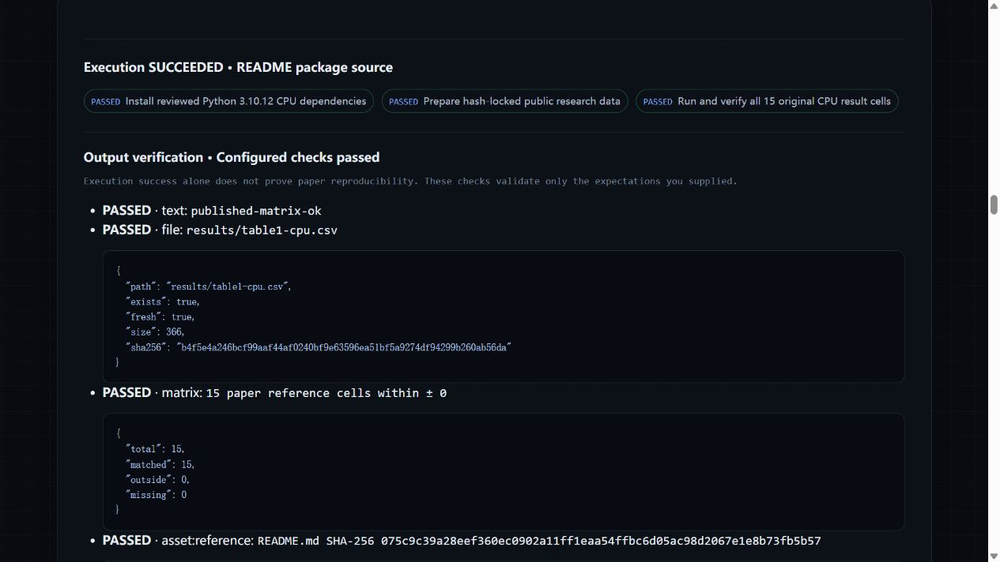
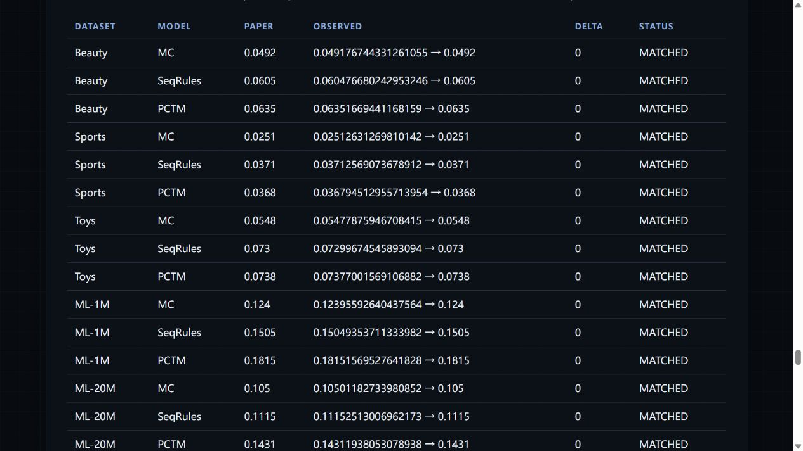
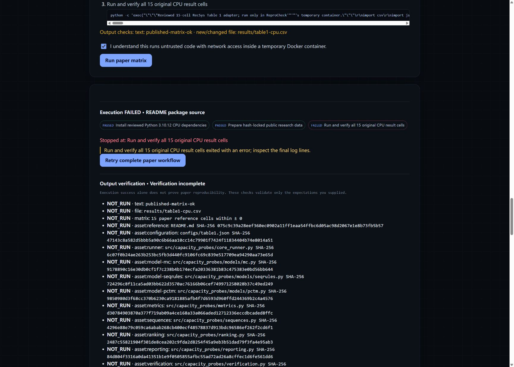

# Spotify: from repository inspection to a 15-cell CPU comparison

[← Project home](../README.md) · [Advanced usage](advanced-usage.md) · [Verification](verification.md) · [Testing](testing.md)

## Question

Can a researcher run the deterministic CPU subset of Spotify Research's Sequential Capacity Probes and check each result against its published reference table?

The reviewed source is [spotify-research/sequential-capacity-probes at 705710f](https://github.com/spotify-research/sequential-capacity-probes/tree/705710f78abd613cd8ee139f7435d813eef2f8ab). The comparison covers Beauty, Sports, Toys, MovieLens 1M and MovieLens 20M with MC, SeqRules and PCTM: **15 Table 1 cells**, using full-catalogue NDCG@10.

## What ReproCheck contributes

The scan screenshot below records the earlier scanner. Current scans reconcile validated Make targets with installation/run findings: `make setup` / `make dependency` are recognized, and **Start here** recommends reviewing `make test` in Quick, with setup/data prerequisites shown. The original scan's three command-detection warnings are therefore removed (7 → 4); this is improved recognition, not a new successful execution. The reviewed 15-cell CPU matrix below remains a separate workflow.

The web scan reports 104 files, zero blockers and seven warnings at this pinned revision. In particular, its basic command checks say installation and runnable commands were not found. The repository uses Make workflows, so these messages expose a detection limit rather than proving that instructions are absent. Review the generated workflow adapters and source links before acting on a warning.

The scan attaches findings and command references to a pinned source revision. The reviewed preset then fixes the environment, data identities, execution entry and reference values. It runs the authors' code in a temporary Docker container and collects a per-cell comparison plus downloadable evidence.

This reduces the work of locating instructions, recording the chosen configuration and manually comparing 15 numbers. We have not yet measured time saved by independent users.

## An actual problem and the human decision

The CPU path computes its results without Torch. However, the upstream deterministic launcher's final global environment verification requires Torch 2.7.1 and raises `ValueError: mc: torch None is not frozen` in the lean CPU environment.

A human reviewed this difference and chose a Python 3.10.12 CPU profile. The adapter accepts that known failure only alongside checks on all 15 original result files, the clean pinned source, exact CPU package versions, dataset hashes, agreement between the original official and independent metrics, and four-decimal reference parity. It does not modify the original model or metric implementations.

This compatibility judgment is specific to the reviewed case. A scan warning alone cannot decide whether an environment difference is scientifically acceptable, whether a dataset split is appropriate, or whether a README result is the right claim to reproduce.

## Repeat the web workflow

Start with the [README installation instructions](../README.md#first-run-scan-only), then follow the Docker workflow below.

### Run the CPU matrix

**Verified through the web interface on 2026-10-21:** Spotify's deterministic CPU subset completed in **5 min 37 sec**, with **15/15 reference cells matched** and all **26 source/data identities passed**. Evidence download and reopening the saved report after a page reload were checked. This is a reviewed subset, not full-paper reproduction. The [case study](#scope-and-interpretation) includes actual screenshots, the initial disk-full failure and the human compatibility decision.

Start **Docker Desktop with Linux containers** and wait until its engine is running. Allow enough Docker memory for a **6 GB** container and disk space for public datasets and dependencies; MovieLens 20M is a substantial download. The reviewed profile uses **4 CPUs** and a **60-minute maximum**. Download and execution times depend on your machine and network.

1. Load **published Spotify CPU matrix benchmark** on the page.
2. Select **Check local runner**. Review the three steps, resource limits and disclosed CPU compatibility profile.
3. Confirm temporary-container execution and select **Run paper matrix**.
4. Wait for the run to finish. A successful acceptance shows **Execution SUCCEEDED**, **Output verification · Configured checks passed**, and **Paper matrix · 15/15 matched**. The saved record calls the output-check status `VERIFIED`. Starting a run or seeing a successful scan is not sufficient.
5. Download the execution evidence. Open the same run under **Recent executions** to inspect it again after restarting the server.

The case covers five datasets × MC, SeqRules and PCTM, with NDCG@10 compared at the paper's four printed decimal places. [Read the case study](#scope-and-interpretation) for the observed environment issue, manual decisions, results and remaining limits.

The preset is [spotify-cpu-matrix.json](../examples/spotify-cpu-matrix.json); the readable container adapter is [evaluate-capacity-matrix.py](../examples/evaluate-capacity-matrix.py). Inputs are checked before and after the experiment. The runner hashes the resulting CSV and retains observed values, reference values, differences and per-cell statuses.

## Scope and interpretation

### Successful browser acceptance on 2026-10-21

Run `3d8caab1-f514-49da-b218-a86721ba1462` completed through the web interface in **336.53 seconds (5 min 37 sec)**, including installation and data preparation. The page displayed **Execution SUCCEEDED**, **Output verification · Configured checks passed**, and **Paper matrix · 15/15 matched**. The downloaded JSON recorded `SUCCEEDED` and `VERIFIED`, all 26 source/data identity checks passed, and zero missing or outside-reference cells. After a page reload, **Recent executions → View record** reopened the same successful report.

Each value below is the observed NDCG@10 rounded to the paper's four printed decimal places. Every value matched its pinned reference with zero difference at that precision; this is not a claim of exact equality between unrounded measurements and printed values.

| Dataset | MC | SeqRules | PCTM |
| --- | ---: | ---: | ---: |
| Beauty | 0.0492 | 0.0605 | 0.0635 |
| Sports | 0.0251 | 0.0371 | 0.0368 |
| Toys | 0.0548 | 0.0730 | 0.0738 |
| ML-1M | 0.1240 | 0.1505 | 0.1815 |
| ML-20M | 0.1050 | 0.1115 | 0.1431 |

The fresh `results/table1-cpu.csv` was 366 bytes, SHA-256 `b4f5e4a246bcf99aaf44af0240bf9e63596ea51bf5a9274df94299b260ab56da`. Execution evidence is downloaded locally, not automatically published. This browser acceptance covers the Spotify preset, preflight, execution, live status, result comparison, evidence download and saved-report reopening. It is not a fresh real-Docker regression of every other preset, cancellation, frozen replay or mobile layout. Offline tests and the production build also passed before the accepted run.

### Browser acceptance on 2026-10-21: blocked by host storage

The actual web flow loaded the pinned preset, checked Docker, accepted execution confirmation and started run `ec8679f2-8cc9-46db-9078-ae34a2e8ba24`. Dependency installation and dataset preparation passed. Logs recorded all 12 model runs for Beauty, Sports, Toys and ML-1M as done, then MovieLens 20M failed with `OSError: [Errno 5] Input/output error`. Docker also reported an I/O error writing its own metadata database.

The host drive holding Docker's virtual disk had about 20 MB free. The page correctly showed **Execution FAILED** and **Verification incomplete**; no fresh 15-cell result matrix was accepted. This attempt does **not** establish a successful end-to-end browser run. The earlier September CPU calculations matched 15/15 references, but they are a separate observation.

Docker's disk was subsequently backed up, checked with SHA-256, and moved through Docker Desktop's disk-image-location setting to a drive with more free space. The original four containers, images and Jenkins volume remained listed after the engine restarted. A follow-up attempt was interrupted by development-server hot reload while offline tests temporarily changed example fixtures; it is not counted as an accepted run. Run these tests before, not during, a live experiment. The next preflight hit GitHub's anonymous API quota. Setting a server-only GitHub token and running the server without file watching allowed the successful browser acceptance reported above. Storage migration and passing offline tests alone were not treated as proof of success.

Before retrying, ensure the drive holding Docker's disk image has substantial free space for dataset copies and caches. Moving the source checkout to another drive alone does not move Docker's storage. Do not repeatedly retry a container while the host disk is full.

- This checks the deterministic CPU subset of one paper. Four other model columns and GPU experiments are outside this acceptance.
- Matching rounded NDCG@10 values is evidence of agreement with those table cells; it is not independent validation of the paper's overall conclusions.
- The preset was manually reviewed. Automatically discovered workflows still require review of inputs, commands, outputs and protocol gaps.
- Container observations and hashes help identify what ran; they are not a security certification. Repository code runs with network access in a temporary container without host mounts or host credentials.

## Second reviewed paper: Sequential Capacity Probes

**Load published Beauty benchmark** selects the Beauty/MC cell from Spotify Research's accepted RecSys 2026 paper, [“Do Sequential Recommendation Benchmarks Really Require Higher-Order Sequence Modelling?”](https://github.com/spotify-research/sequential-capacity-probes). The case pins repository commit `705710f`, the paper's pinned eSASRec data builder, the public S3Rec Beauty source, generated train/holdout hashes, seven source/configuration files and the exact Table 1 row.

The run uses the authors' original deterministic empirical Markov Chain builder, full-catalogue ranking, RecTools NDCG@10 calculation and independent NDCG implementation under exact Python 3.10.12. It installs only the CPU code's imported dependencies. The adapter deliberately does not invoke the repository's full-matrix environment verifier because that requires unused Torch 2.7.1/CUDA even for MC; this compatibility boundary is displayed before execution and retained in evidence. No model, ranking or metric code is replaced.

The 2026-09-23 local acceptance run completed in **22.796 seconds**. Original official NDCG@10 was **0.049176744331261055** and the paper's exact-four-decimal protocol produced **0.0492**, matching the pinned Table 1 value with zero tolerance. All ten code/data/reference identities passed. This is one deterministic CPU cell, not reproduction of the other four datasets, factorized methods, GPU transformer runs or the full paper.

**Load published Spotify CPU matrix benchmark** expands that acceptance to **5 datasets × 3 original CPU models = 15 Table 1 cells**: MC, SeqRules and PCTM on Beauty, Sports, Toys, ML-1M and ML-20M. It pins 16 source/configuration files and all ten generated train/holdout files, runs the authors' deterministic launcher, requires every original JSON result, checks the official and independent NDCG@10 values agree, and compares every value with the pinned README at four decimals. The fresh `results/table1-cpu.csv` is then checked cell by cell by the normal paper-matrix collector.

The 2026-09-23 local acceptance finished the 15 original calculations in about **5 minutes 47 seconds**; all 15 matched Table 1 with zero four-decimal difference. The upstream launcher then raised `mc: torch None is not frozen` because its global verifier requires Torch 2.7.1 even for these three Torch-free CPU models. The reviewed adapter accepts only that exact post-computation compatibility boundary and performs the source, environment, data, metric and table checks itself. This reproduces the paper's deterministic CPU subset, not its four GPU/factorized model columns or the entire paper.

## Feedback we need

Try the workflow and note: which finding changed your next action, which label was unclear, where you got stuck, and how long it took to get a useful report. A failed run with a precise failure stage is useful feedback too. Remove tokens and private information before sharing logs.
