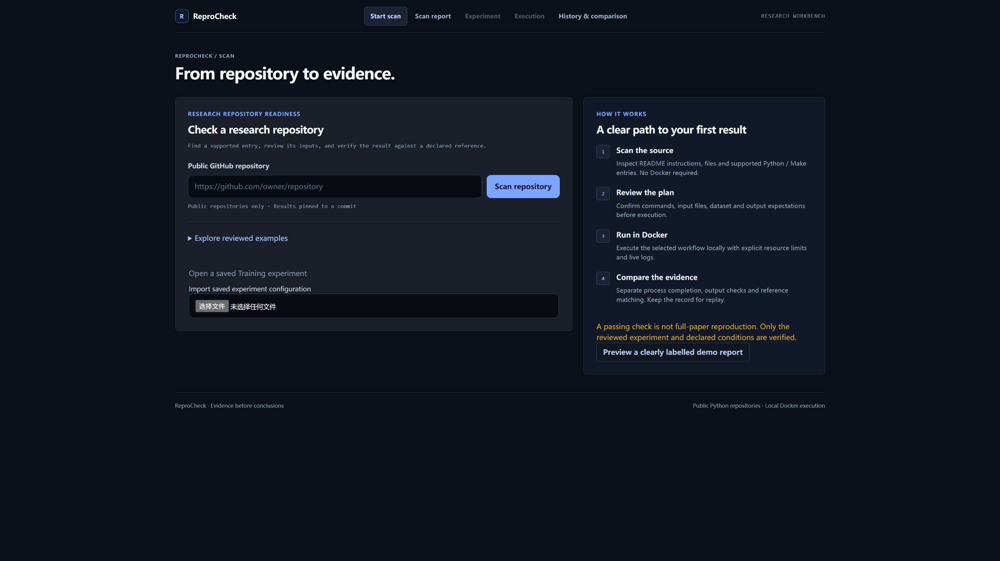
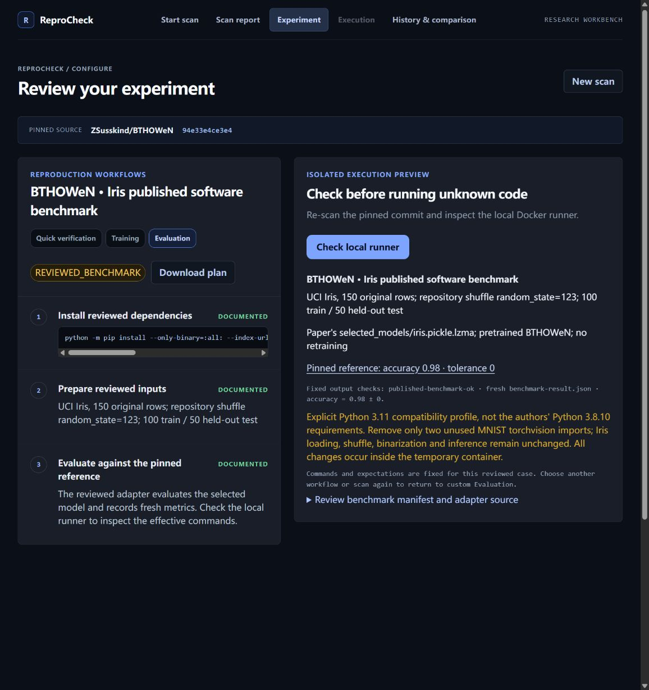

# Stitch UI integration review

Developed on `feat/stitch-desktop-ui`. This record covers the local UI validation;
it does not certify a hosted deployment.

The existing React frontend now uses the supplied Stitch project's dark desktop
workbench layout. These are adaptations to supported ReproCheck features, not
ten static HTML pages or a new backend.

## Changes

- Start: repository form, saved JSON import, expandable reviewed examples and an explanation of the scan-to-result workflow.
- Report: pinned source, recommended entry, checks and expandable provenance/protocol evidence.
- Experiment: desktop columns for the plan and runner configuration; existing input/review requirements remain in force.
- Execution/results: stage cards and separate process, output-check, reference and scope summaries. Captured evidence remains inspectable in disclosures.
- History: bounded scrolling list, focus on opened records, existing frozen replay and comparison controls.
- Navigation preserves the mounted forms. Scans and presets select the appropriate view; errors remain visible when the user changes views.
- Reviewed evaluation presets now show their own plan instead of an unrelated missing README entry.

No simulated GPU readings, confidence scores, cache metrics, account controls,
GitLab/SSH support or extra preset definitions were copied from the design.

## Validation on 2026-10-26

- `npm.cmd test`: all existing suites passed.
- `npm.cmd run build`: browser and worker builds passed.
- `git diff --check`: passed.
- Browser: actual public Micrograd scan navigated to a pinned report.
- Browser: a custom expected-text value survived switching to History and back.
- Browser: Iris preset selected its fixed commit and reviewed evaluation plan;
  an assertion checked that it did not show an unavailable plan.
- Browser: local preflight displayed Docker not running; an assertion confirmed
  that Run Evaluation remained disabled.
- Browser: an existing successful Iris record displayed its actual 0.98 reference
  result and the selected-experiment scope. No new execution was started.

Not covered: fresh Docker execution, every preset's browser path, import/export
round trip after this layout change, and real narrow-window/device testing.
The CSS includes a single-column breakpoint for narrow windows; mobile feature
parity is not part of this change. Navigation is local state, not URL routing;
refreshing the page returns to Start and clears unsaved browser-only fields.

## Screenshots

