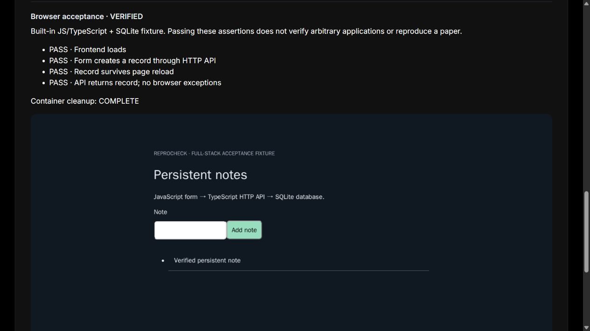

# Web application verification

## Real repository: Sydney task planner

The reviewed private case uses `mkri3904/SOFT3888_F16_04_P28` on
`github.sydney.edu.au`, fixed at **49ffe892d6881f7d0e99c3cf2b5c801588bb5464**.
It runs the repository's unmodified **React/Vite frontend + FastAPI backend + SQLite**.
It does not follow a moving branch, edit the upstream source or copy private source into
ReproCheck's tracked files.

1. Authenticate the host GitHub CLI: `gh auth login --hostname github.sydney.edu.au`.
   Your account must have read access to this private repository.
2. Start Docker Desktop (Linux engine) and run `npm run setup:planner` once.
3. Start ReproCheck, choose **Web verification → Sydney task planner**.
4. For the reproducible non-AI path leave **Also verify live Gemini** unchecked. Confirm
   execution and run. No real Gemini key is needed for this mode.
5. To additionally verify real model generation, enable that checkbox and enter a Gemini
   API key in the password field. This uses the provider's quota and may incur usage costs.
   The field is cleared after startup; live retries require re-entering the key.

The host fetches only the pinned source using its existing Git credentials. Only an archive
of `Backend/` and `Frontend/` enters Docker—no `.git`, host database, `.env`, GitHub token or
host filesystem mount. Symlinks and unreviewed path types are rejected.

The runner installs the backend dependencies and records `pip freeze`, runs frontend
`npm ci` and `npm run build`, then starts Uvicorn on 8000 and Vite preview on 5173 inside
the container network namespace. Both services must become ready. The existing repository
has a frontend lockfile but **does not fully pin Python dependencies**; the captured freeze
records resolved versions rather than guaranteeing future installations are identical.
The adapter explicitly installs `python-dotenv` and `requests`, which are imported by the
backend. It does not change the repository's requirements file.

Acceptance uses the real browser controls to create a task, change its time range, mark it
completed, reload and verify the state through both UI and API, then delete and reload again.
A separate screenshot preserves the edited/completed task before deletion.

Manual-only mode disconnects the container network after installation. An inert placeholder
satisfies the repository's import-time Gemini-key requirement, and no AI service is called.
Live mode keeps network access, supplies the key only over stdin to the backend launch
process, and submits one synthetic study-planning prompt through the UI. It checks that a
nonempty generated plan is saved and visible after reload. **This checks generation and
persistence, not plan quality or deterministic model output.** Google OAuth, regeneration,
PostgreSQL, external calendars and every other application feature remain outside this case.

The real key is not a Docker command-line argument, image layer, container configuration
environment variable, repository file or saved run field. It exists in the local server and
backend process memory/environment while running. Reports redact the supplied key. Repository
authentication is never passed to the application. Do not expose the local runner publicly.

Use `npm run test:planner` for the private-repository Docker test; it requires repository
access but uses no live API key. Live provider failures appear separately from manual-task
assertions. Temporary databases are discarded and local source/evidence remain under ignored
`.reprocheck/`. Cached images and dependency downloads occupy Docker disk space.

### Local acceptance recorded on 26 October 2026

- Manual browser acceptance passed, including installation, build, startup, task creation,
  rescheduling, completion, deletion and reload persistence.
- Cancellation during dependency installation followed by a clean retry passed; no run
  containers remained.
- One live Gemini acceptance returned HTTP 200 and generated two tasks, both present after
  reload. Local record: `9230dd4c-6a8a-47d2-b3e1-e939449b7eb7`.
- All five assertions passed and container cleanup completed. A later server restart and
  the History view successfully reopened that record and its screenshots.
- The provided API key was not found in saved evidence or implementation files. Private
  source archives and screenshots remain in ignored local storage, not in public docs.

This observation used the pinned commit above and records one successful live response;
provider availability, quota and later generated output can differ.

## Built-in notes fixture

The first supported Web case is **Persistent notes**, bundled in `examples/web-notes/`.
It has a JavaScript browser form, a TypeScript HTTP API and a SQLite database. Node 24 runs
the TypeScript directly. The application uses only Node standard-library modules, so its
lockfile currently has no third-party dependencies. `npm ci` is still executed and checked.

This is an **authored acceptance fixture**, not an independent GitHub repository or a paper
benchmark. It proves this specific install/start/browser/evidence path; arbitrary npm
repositories, separate frontend/backend ports, npm workspaces, cloud services and custom
browser scripts are not supported by this entry yet.

## Run it

1. Start Docker Desktop with Linux containers.
2. In the ReproCheck directory run `npm run setup:web` (PowerShell: `npm.cmd run setup:web`).
   This builds the shared browser image using Node 24.14.0 and Playwright 1.64.0. It downloads
   Chromium and OS packages once. Subsequent runs reuse the image. Re-run this command after
   changes to `web-verification/`. Docker build caches consume additional disk space.
3. Start ReproCheck with `npm run dev` and open http://127.0.0.1:5173/.
4. Choose **Web verification**, check the environment, review the scope and tick the execution
   acknowledgement. Click **Run web verification**. No scan or GitHub Token is needed.
5. Expect four stages: environment, locked installation, startup/readiness, browser acceptance.
   On success the page shows **SUCCEEDED**, **VERIFIED**, four passed assertions, a screenshot
   and **Container cleanup: COMPLETE**.

The browser opens the frontend, submits a note, checks the API's HTTP 201 response, reloads
the page, and confirms the note is still displayed and returned by the API. It also checks
for browser JavaScript exceptions. This verifies persistence across a **page reload**, not
across an application restart, machine restart or migration.

## Evidence and lifecycle

- Each run snapshots exactly four application files and records their combined SHA-256,
  the Docker image identity, commands, stages, browser assertions and bounded display logs.
- The application and browser have separate container filesystems. The application cannot
  directly write the browser result file. This is useful test isolation, not a security attestation.
- Both containers use a non-root runtime user with dropped capabilities. The application
  network is disabled; the browser joins that same network namespace and accesses only
  port 3000 on its loopback interface. No host ports, credentials or directories are shared.
- Resource limits are **2 CPUs / 1 GB per container**, a **10-minute overall deadline**, and
  a separate browser timeout. Chromium uses container isolation; this route is limited to
  the reviewed bundled fixture, not arbitrary untrusted websites.
- **Cancel web run** stops the current operation and removes this run's containers. **Retry
  in a clean environment** creates new containers and a new empty SQLite database.
- Completion removes both containers and their database; only the source snapshot, report
  and screenshot remain under ignored `.reprocheck/`. No experimental data is pushed to GitHub.
- **History & comparison → Refresh history → View record** reopens the report and screenshot.
  Python recipe replay/comparison is not exposed for these Web records.
- Keep the server running until cleanup finishes. A forced server exit leaves an interrupted
  record; container timeouts stop execution, but stopped containers may need removal in
  Docker Desktop. Do not delete unrelated containers or volumes.

## Verification for development

`npm test` includes Web input validation and hosted-service rejection.
`npm run test:web` runs real Docker/browser acceptance, cancellation, clean retry and a
negative test with a deliberately missing button. It asserts saved evidence, screenshot,
source hash changes and removal of the run's containers.

The negative test briefly edits and restores the bundled HTML before creating its immutable
snapshot. Run it with the app server stopped or started as `node server.mjs`, not in watch mode.

Passing this flow is not proof that all UI operations, databases or third-party services work.
The existing Python scan and experiment workflow remains separate and unchanged.
